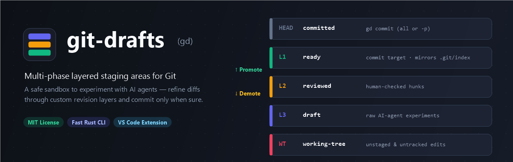
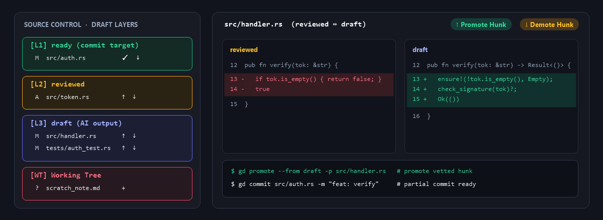
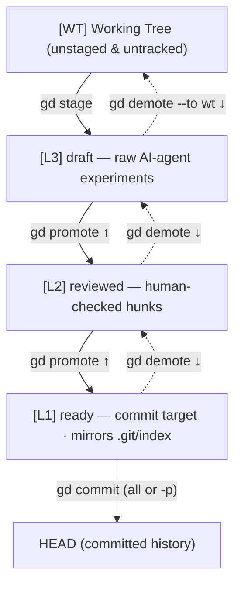

<p align="center">
  
</p>

<p align="center">
  <a href="https://github.com/Girgis98/git-drafts/actions/workflows/ci.yml"></a>
  <a href="LICENSE"></a>
  
  <a href="editors/vscode"></a>
</p>

---

**Multi-phase layered staging areas for Git — a safe space to experiment with AI agents before committing.**

Standard Git gives you three phases: **Working Tree → Index (Staged) → Committed (`HEAD`)**.  
When coding with AI agents, one staging area isn't enough. Agents generate large, fast, half-baked diffs where some hunks are ready, some need another pass, and others are raw experiments.

`git-drafts` (`gd`) lets you stack **as many revision layers as you need** on top of `HEAD` using native Git indices (`GIT_INDEX_FILE`), so you can iterate, isolate hunks, and **never commit until you're sure** — and then commit all or part of your verified layer.

<p align="center">
  
</p>

---

## Why Use `git-drafts`?

- **Built for AI-agent workflows:** Keep raw agent output in `draft`, human-checked edits in `reviewed`, and commit-ready changes in `ready` — without polluting your commit history or losing track of what you actually vetted.
- **As many layers as you want:** Start with `ready < reviewed < draft`, or insert custom phases (`tested`, `security-checked`, `polish`, etc.) at any position in the stack.
- **Hunk-level precision (`-p` & IDE):** Promote, demote, drop, or partially commit individual hunks without touching your working tree.
- **Don't commit prematurely:** Experiment across multiple agent turns in layered draft buffers before anything touches `HEAD`.
- **Seamless VS Code integration:** Embedded **Draft Layers** panel right inside Source Control, bidirectional `.git/index` mirroring, multiselect batch actions, and diff-editor hunk buttons.
- **100% Git-native & fast:** Zero-dependency Rust binary driving Git's own plumbing with stat-keyed tree caching. Zero repo format lock-in; `.git/hooks`, GPG signing, and standard `git` commands keep working.
- **Reversible:** Up to 15 undo snapshots (`gd undo`) plus automatic 3-way `merge-tree` re-anchoring when `HEAD` moves externally.

---

## How It Works

Layers are stored in `.git/drafts/` as an ordered stack of standard Git index files from **most revised (closest to `HEAD`)** to **least revised (closest to Working Tree)**:



Each layer index holds a cumulative tree snapshot (`HEAD ⊆ L1 ⊆ L2 ⊆ ... ⊆ Ln ⊆ WT`):
- What is shown *inside* layer `k` is the exact delta between `L(k-1)` and `Lk`.
- **Promoting (`↑`)** moves paths or hunks toward `ready`.
- **Demoting (`↓`)** pushes paths or hunks away from commit.
- **Committing (`gd commit`)** commits `L1` (`ready`) — or only selected paths/hunks from `L1` — while `L2..Ln` remain intact above the new `HEAD`.

---

## Installation

### Prerequisites
- `git` (2.38+ recommended for 3-way `merge-tree` re-anchoring)
- Rust toolchain (`cargo` / `rustc`)

### Install CLI (`gd` & `git-drafts`)
```bash
cargo install --git https://github.com/Girgis98/git-drafts.git
```
Or build from source:
```bash
git clone https://github.com/Girgis98/git-drafts.git
cd git-drafts
cargo install --path . --locked
```

This installs both `gd` and `git-drafts` (run `gd <cmd>` or `git drafts <cmd>`).

---

## Step-by-Step Guide

### Step 1: Initialize draft layers in any Git repository
```bash
gd init
# Initialized layers: ready < reviewed < draft
```
Enable bidirectional `.git/index` mirroring (for IDEs) or custom layer names:
```bash
gd init --sync-git-index
gd init ready audited draft raw-agent
```

### Step 2: Capture AI-agent edits into the top draft layer
```bash
gd stage -A               # or: gd stage src/auth.rs
gd status                 # alias: gd st
```
```text
[L1] ready (commit target) (0 files)
  (clean)
[L2] reviewed (0 files)
  (clean)
[L3] draft (2 files)
  M  src/auth.rs
  A  src/token.rs
[WT] working-tree (0 modified, 0 untracked)
  (clean)
```

### Step 3: Review diffs per layer
```bash
gd diff draft             # diff of L3 (reviewed..draft)
gd diff wt                # unstaged diff in working tree
gd diff --from head --to draft
```

### Step 4: Promote verified changes toward `ready`
```bash
gd promote src/token.rs                          # draft -> reviewed
gd promote src/token.rs                          # reviewed -> ready
gd promote --from draft --to ready -p src/auth.rs # interactive hunk split
```

### Step 5: Experiment further without risking vetted work
Let your agent continue editing `src/auth.rs` in the working tree, then stage new experiments into `draft`:
```bash
gd stage src/auth.rs
```
Previously promoted hunks stay isolated in `ready`/`reviewed`, while new experiments sit cleanly above them in `draft`.

### Step 6: Commit all of `ready`, or only part of it
```bash
gd commit -m "feat(auth): add token validation"         # commit entire ready layer
gd commit src/token.rs -m "feat(auth): add token util"  # partial file commit
gd commit -p -m "feat(auth): partial auth fix"          # partial hunk commit
```

### Step 7: Demote, drop, or undo mistakes
```bash
gd demote src/auth.rs                     # move one layer toward WT
gd demote --from draft --to wt -A         # unstage draft back to working tree
gd drop draft --cascade src/exp.rs        # remove from draft & upper layers (keeps WT)
gd drop draft --hard src/exp.rs           # remove from layers AND revert WT
gd undo                                   # restore previous layer state (last 15 ops)
```

### Step 8: Add, rename, or remove layers anytime
```bash
gd layer list
gd layer add qa --above reviewed          # insert phase between reviewed & draft
gd layer rename qa security-check
gd layer rm security-check --merge-down   # or --merge-up / --drop
```

---

## VS Code & IDE Integration

`git-drafts` integrates at three levels:

1. **VS Code / Cursor Extension ([editors/vscode](editors/vscode)):**
   - **Draft Layers** tree directly inside Source Control (with multiselect `Stage`, `Promote ↑`, `Demote ↓`, `Drop`, `Commit File`)
   - Dedicated **Git Drafts** Activity Bar (`Draft Pipeline` webview + `Changed Files` tree)
   - Inline actions on built-in VS Code Git items (`Stage to Top Draft`, `Stage to Layer...`, `Demote from Ready ↓`)
   - Diff editor title buttons (`Promote Hunk ↑` / `Demote Hunk ↓`) and live Status Bar counter
   ```bash
   cd editors/vscode
   npm ci && npm run compile
   npx @vscode/vsce package --out git-drafts-0.1.0.vsix
   code --install-extension git-drafts-0.1.0.vsix
   ```
2. **Bidirectional `.git/index` Mirror (any IDE):**
   `gd config sync-git-index true` keeps `[L1] ready` synced with `.git/index`, so built-in Git UIs show `ready` under **Staged Changes** while `reviewed`/`draft` stay isolated.
3. **Machine-readable CLI Primitives:**
   `gd status --json`, `gd blob <layer|head|wt> <path> --allow-missing`, and `gd patch-apply --from A --to B`.

---

## Command Reference

| Command | Description |
| :--- | :--- |
| `gd init [--force] [--sync-git-index] [layers...]` | Initialize layers (default: `ready reviewed draft`) |
| `gd status` / `gd st [--json]` | Show parallel per-layer file status (`L1..Ln` + `WT`) |
| `gd diff [<layer>\|wt] [--from A --to B] [-- <paths...>]` | Show diff for a layer or between any two states |
| `gd stage [-l <layer>] [-p\|-A] [<paths...>]` | Stage `WT` changes into `<layer>` (default: top layer) |
| `gd promote [--from L] [--to L] [-p\|-A] [<paths...>]` | Move changes toward `HEAD` (`ready`) |
| `gd demote [--from L] [--to L\|wt] [-p\|-A] [<paths...>]` | Move changes away from commit |
| `gd drop <layer> [-p\|-A] [--cascade] [--hard] [<paths...>]` | Discard changes from a layer |
| `gd commit [-p] [<paths...>] [git-commit-opts...]` | Commit `[L1] ready` (all or selected paths/hunks) |
| `gd layer list \| add \| rm \| rename` | Manage revision layers dynamically |
| `gd blob <spec> <path> [--allow-missing]` | Print raw file bytes at a layer/`head`/`wt` |
| `gd patch-apply --from A --to B` | Apply unified diff from stdin between layers |
| `gd config sync-git-index [true\|false]` | Mirror `[L1] ready` into `.git/index` |
| `gd undo` | Restore previous layer snapshot |

---

## License

Licensed under the [MIT License](LICENSE).
