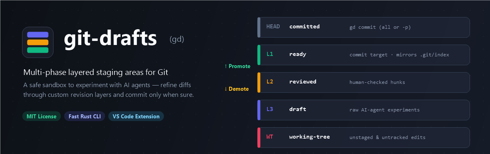
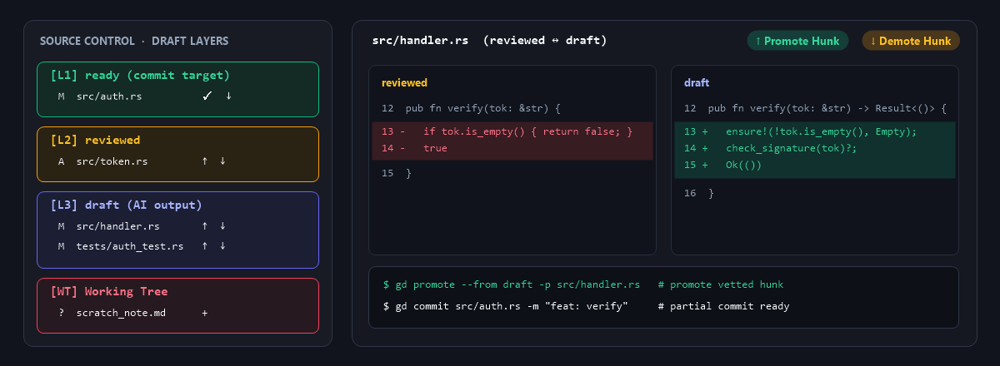

# Git Drafts for VS Code

**Multi-phase layered staging areas for Git — a safe space to experiment with AI agents before committing.**

Stop forcing messy AI-agent edits into a single Git staging area. `Git Drafts` integrates directly into **Source Control** and adds a dedicated **Git Drafts** Activity Bar view, diff-editor hunk controls, and bidirectional `.git/index` sync powered by [`gd`](https://github.com/Girgis98/git-drafts).

## Features

- **Seamless Source Control Integration:** Adds a **Draft Layers** tree directly inside VS Code's built-in Source Control sidebar plus inline actions (`Stage to Top Draft`, `Stage to Layer...`, `Demote from Ready ↓`) on built-in Git items.
- **Bidirectional `.git/index` Mirror:** `[L1] ready` stays synced with Git's **Staged Changes** — stage/unstage from either Git Drafts or built-in Git seamlessly.
- **Activity Bar Pipeline View:** Visual stack of your revision layers (`HEAD ← ready ← reviewed ← draft ← WT`) with file count badges, `Promote ↑` / `Demote ↓`, `+ Layer`, `Undo`, and `.git/index` mirror toggle.
- **Multiselect Batch Actions:** Select multiple files (`Ctrl+Click` / `Shift+Click`) to `Stage`, `Promote ↑`, `Demote ↓`, `Drop`, or partially `Commit` in one click.
- **Diff Editor Hunk Controls:** When viewing any `git-drafts` side-by-side diff, promote or demote the hunk at your cursor directly from the editor title bar (`Promote Hunk ↑` / `Demote Hunk ↓`).
- **Status Bar Counter:** Live summary (`Drafts: ready(1) · reviewed(0) · draft(2)`) in the status bar.

## Zero-Step Setup

No manual CLI install required — on first launch, the extension automatically downloads the prebuilt `gd` binary for your platform (Linux, macOS, or Windows, including Remote-SSH) if it is not already on `PATH`.

*(Optional standalone CLI install: `cargo install --git https://github.com/Girgis98/git-drafts.git`)*

## Quick Start

1. Open any Git repository in VS Code.
2. In **Source Control**, click **`.git`** under `Not Initialized` (or run `Git Drafts: Initialize Draft Layers`).
3. Stage AI-agent edits to `draft`, inspect diffs (`reviewed ↔ draft`), promote verified files or hunks up (`↑`) to `ready`, and commit all or selected files when you're sure.

## Extension Settings

- `gitDrafts.executablePath`: Path to the `gd` binary (default: `"gd"`, with automatic fallback to `~/.cargo/bin/gd` and `<workspace>/target/release/gd`).

## License

[MIT](LICENSE)
